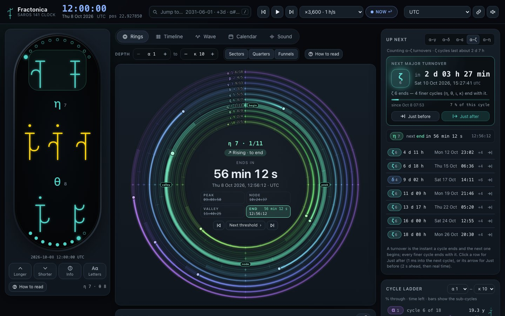
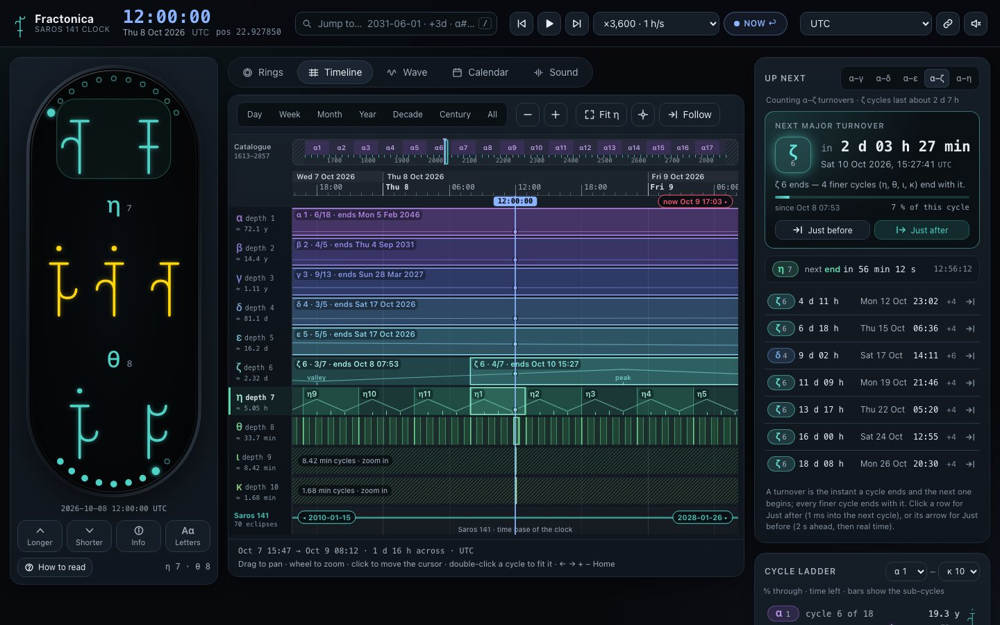
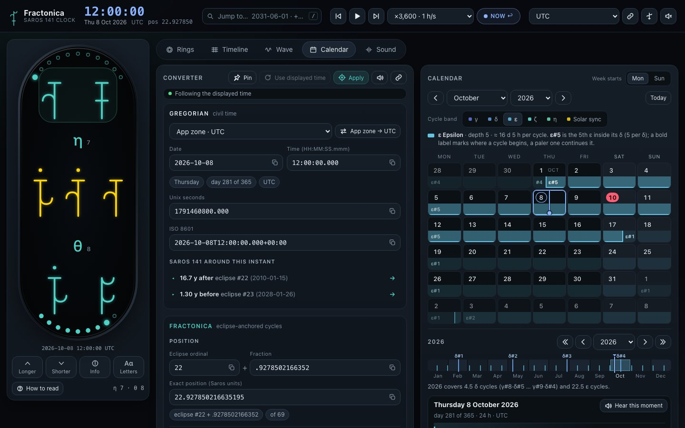
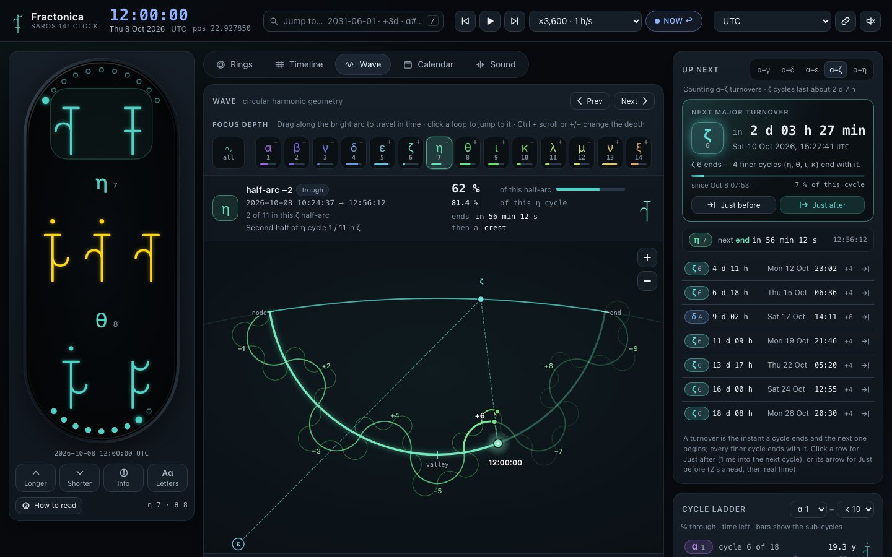
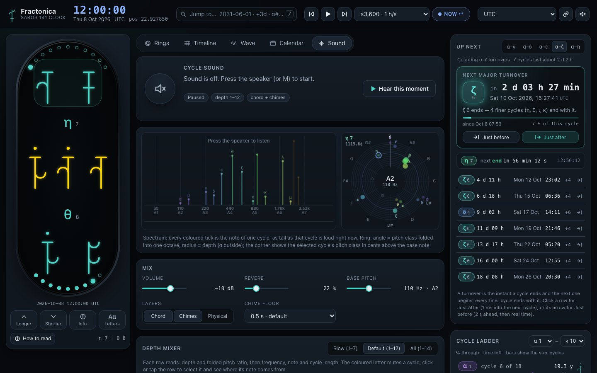
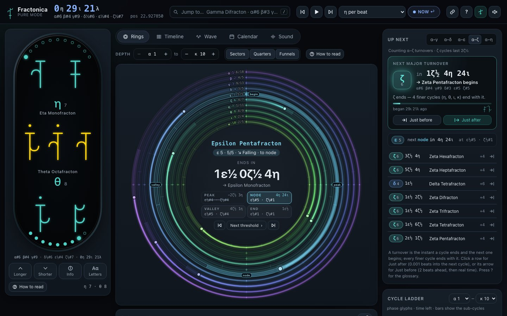
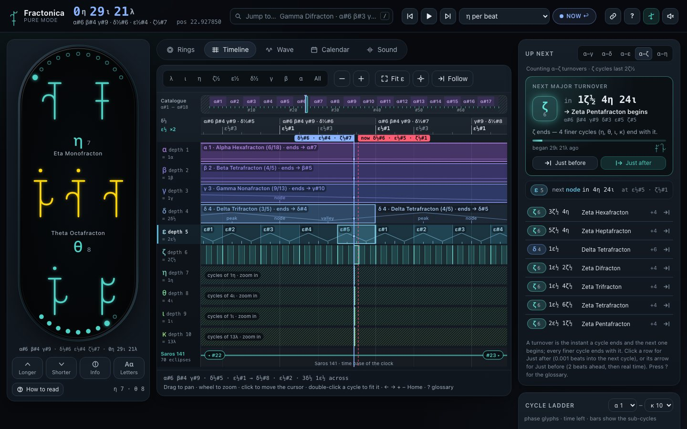
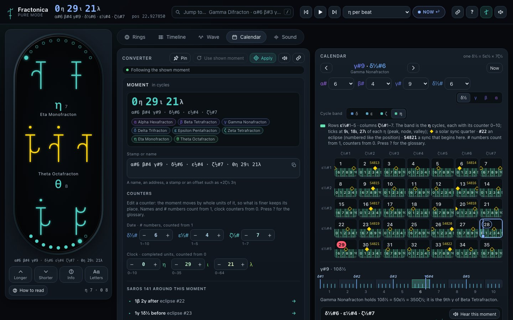
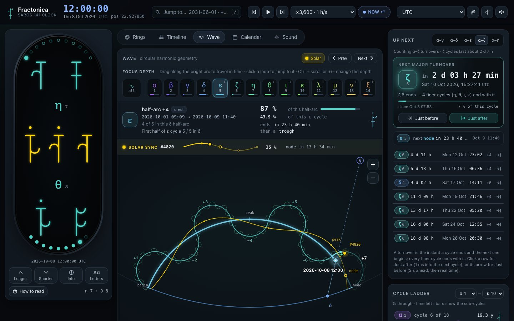

# Fractonica Clock

A web app for the **Fractonica clock**: an eclipse-anchored harmonic clock whose time base is the Saros 141
eclipse series (70 greatest eclipses, 1613 → 2857). It implements [`SPEC.md`](SPEC.md) on top of the reference
library [`fractonica.js`](fractonica.js) and adds three things the spec does not cover:

1. **Cycle visualisations** – see exactly where you are in every cycle, move through time, and estimate when the
   next major cycle turns over.
2. **Calendar mapping** – go from Fractonica time to Gregorian time and back.
3. **Sonification** – hear the cycles.
4. **Pure mode** – the same instrument with nothing Earthly in it: no Gregorian dates, zones, Earth time units or
   percentages; only Fractonica periods, names and glyphs.

No build step and no dependencies: static files and vanilla ES modules.



<p>
 
 
</p>

```bash
npm start            # serves http://localhost:5199  (PORT=8080 npm start for another port)
npm test             # node --test: spec vectors, formatting, store and every module's pure logic
npm run check        # headless-browser regression checks (needs Playwright core + Chromium, see tools/browse.mjs)
```

## What is in the app

| Area | What it does |
|---|---|
| **Clock face** (left) | The journal face (default): three units as the diary writes them ("34η 29ι 21λ") with the phase of the period above at the top; a major period alone in words ("5th / Delta / Trifracton / End") under its big 3-stroke glyph, the longest unit's cycle as two arcs with a tick at the bottom; tap the top or the bottom to move one unit longer or shorter. The **Watch** button switches to the spec's watch face (SPEC §8–§10) as SVG: two period odometers (default depth 7 over depth 8), sibling counters on the rounded ends, the gold 4-day solar-sync odometer, period letters and info labels. Tap top/bottom to change depth, middle for info, double tap for letters. Hover any glyph for a plain-language reading. |
| **Rings** | Concentric dial, outermost = longest cycle. Each ring shows its phase, its sectors (the next level's cycles), quarter marks (peak / node / valley / end) and a funnel into the next ring. The centre counts down to the end of the selected cycle; click sectors to travel; a waveform inset explains peak/node/valley and scrubs inside the cycle. |
| **Timeline** | Zoomable, pannable multi-scale timeline from the whole catalogue (the 70 eclipses) down to seconds, with the Gregorian axis on top and one lane of cycle blocks per depth. Presets, follow mode, hover read-out, "fit this cycle". |
| **Wave** | The library's circular harmonic geometry as a "you are here" map with one marker per level, zoomable to any depth. |
| **Calendar** | Two-way converter (Gregorian date/time/zone/Unix ⇄ Saros position, cycle address, glyph states, solar sync) and a Gregorian month calendar whose day cells show cycle boundaries at their exact time of day, plus a year ribbon. |
| **Sound** | The harmonic hierarchy as a just-intonation chord (loudness follows each cycle's phase), chimes at peak / node / valley / end where a major boundary rings as a chord of every level that turns over together, time-lapse and tempo lock, and "hear this moment". |
| **Diary** | A printable diary of one Delta (81 days): an index, a Gregorian index, a lunar and solar ephemeris, planning and prediction pages, then every Helion on paper. A sheet holds 5 Helions: 3 lined on the front, 2 canvases on the back. Four sheets make a 19-Helion lock, and four locks plus a retrospection Helion make a Nuclide. Exported as a PDF; every part of the format is configurable. |
| **Cycle ladder / Up next** (right) | One row per depth with progress, counter and time left; the next turnovers of the cycles you care about with live countdowns. |
| **Header** | Live Gregorian time and Saros position, a jump box (`/` to focus: `2031-06-01 14:30 Moscow`, `+3d`, `α#6 β#3 γ#11`, `pos 24.5`, `sync 4820`, `next ε`…), transport (previous / next cycle, time-lapse ×1 … ×31.6 M, back to live), time zone, link to this moment, sound. |

Time travel is global: every view shows the same displayed time, whether it is the device clock (**LIVE**), a chosen
instant, or a time-lapse. The catalogue ends are respected; nothing is extrapolated.

### Pure mode

Press **P** (or the glyph button in the header, or open `?pure=1`) and the clock stops translating. Everything is said in
Fractonica terms ([SPEC.md §15](SPEC.md)):

- **Major and minor periods.** Alpha, Beta, Gamma and Delta are the *major* periods. They are said in words, with their place in
  the parent and the quarter they are in: `Delta Trifracton Node` (Mono-, Di-, Tri-, Tetra-, Penta- … Octadecafracton; quarters
  Peak, Node, Valley, End). Below them the *minor* units take every other depth and are said in letters:

  | | δ | ε | η | ι | λ | ν |
  |---|---|---|---|---|---|---|
  | unit | Delta | Nuclide | **Helion** | **Preon** | **Flavon** | Blink |
  | made of | 5 ε | 77 η | 36 ι | 65 λ | 25 ν | – |
  | like | a month | a week | an hour | a minute | a second | |

  The depths between (ζ θ κ μ) are still drawn, but they are not units: ζ lasts 11η, θ 4ι, κ 13λ, μ 5ν.
- **Where you are.** The header shows the Helion number in the Nuclide (1–77), the Helion phase as two glyphs, then Preons and Flavons
  (`34η ‹phase› 29ι 21λ`), and the date `Delta Trifracton End ε#5`. The full date is
  `Alpha Hexafracton Valley, Beta Tetrafracton Valley, Gamma Nonafracton Valley, Delta Trifracton End, ε#5 34η 29ι 21λ 3ν`,
  and in letters `α#6 β#4 γ#9 δ#3 ε#5 34η 29ι 21λ`.
- **How long.** Spans are counts on the ladder: `5η 17ι`, `6ι 43λ`, `2ε 10η`; below a Blink, a decimal (`0.14ν`).
- **How far through a cycle.** Two 2-stroke glyphs (16 × 16 = 256 states) instead of a percentage. The major periods show
  their quarter word instead, since their phase follows from the counts.
- **How fast.** Real time is counted in **Blinks**. Time-lapse speeds are units per Blink (`4ι per Blink`, `η per Blink`), and a
  frequency is cycles per Blink, **pB**, instead of Hz.
- **Navigation keeps working.** The timeline gets a ruler of units, and the Calendar tab becomes a converter and a page of one
  Delta (5 Nuclides × 77 Helions). The jump box reads every date form, plus offsets like `+2ε 5η` or `+4 Blinks`.
- Press **?** for the in-app glossary.

The mode is presentation only: the clock still runs on the device time underneath, and switching back and forth is live.
Design notes: [`docs/design/80-pure.md`](docs/design/80-pure.md).

<p>
 
 
</p>

### The diary

The **Diary** tab lays out one Delta as a printable book. Choose the Delta and the format: paper, margins, how many
Helions a sheet holds, lines per Helion, canvases, front matter, events and ink. Then **Export PDF** opens the browser's
print dialog, where "Save as PDF" writes the file. From the command line, `npm run diary -- --path 6,4,9,3 --out diary.pdf`
writes the PDF directly; add `--pairing duplex` for double-sided A4: print the odd pages, put the stack back in, print
the even pages, cut the sheets in half and lay the left halves on the right halves. Each lined Helion carries its quarter ticks with their glyphs and a curve of its wave in the
outer margin. Lunar events (synodic, anomalistic, draconic and sidereal months, with quarters) and solar events (equinoxes,
solstices, perihelion, aphelion) appear at their exact place, with Gregorian and Fractonica times. Each solar lock is three Pentads (5 Helions: 3 lined, 2
canvases) and an all-canvas Semi-pentad; a thumb index on the outer edge links each page to the same Helion in the
next and previous Nuclide and to the neighbouring Semi-pentads, locks, Nuclides and Delta sheets. The Sun and Moon over
your place (the zone's city by default) are drawn on every page with their rises, culminations and sets, and the 77th
Helion of each Nuclide has a 7 × 11 grid to mark every Helion. Each eclipse gets two sheets: its path on a gnomonic cube map (or the Moon in the Earth's shadow) with
its circumstances and Saros series, the whole series with Fractonica addresses, and its Helion with every contact on a
Preon and Flavon timeline. A reference sheet
after the ephemeris holds the period ladder (all 63 levels, how they are derived, periods and frequencies) and the
milestones of the diary's Alpha, its Betas and Gammas, with the eclipses on them. Design:
[`docs/design/90-diary.md`](docs/design/90-diary.md).

### The solar wave

In the Wave view, the **Solar** button adds a yellow wave for the solar sync (19 Helions ≈ 4 days): a marker at the current sync
phase with its four quarter ticks, and a ripple of one sync wavelength along the focused arc where it fits (`?solar=1`).

### Reading the labels

`ε 5` is a **depth chip** (ε is always depth 5, an ≈16-day cycle). `ε#5` is the **5th ε inside its parent δ**, and
`α#6 › β#4 › γ#9` is a cycle address. `d7#717211` is the global index of a depth-7 cycle. Glyph states use the spec's
0-based index (`13 of 0–15`).

### Keyboard

`Space` play/pause time-lapse · `N` back to live · `[` / `]` previous / next cycle of the selected level ·
`1`…`6` switch view · `M` sound on/off · `P` pure mode · `?` pure glossary · `/` or `Ctrl/⌘+K` jump box · face: `↑` `↓` depth, `I` info, `L` letters.

### Deep links

`index.html?t=<unix seconds | ISO with zone> | pos=<Saros position>&view=rings|timeline|wave|calendar|sound&zone=<IANA>&rate=<n>&depth=<top depth>&sel=<selected depth>&pure=1&solar=1`
— e.g. `?t=1791460800&view=timeline&zone=UTC` is the spec's test vector A (2026-10-08T12:00:00Z). The header link
button copies a link to the displayed moment (a `?pos=` link in pure mode).

## Architecture

See [`docs/ARCHITECTURE.md`](docs/ARCHITECTURE.md) for the module contract. In short:

```
src/core/model.js   the only code that talks to fractonica.js (checked against SPEC §12 vectors)
src/core/store.js   displayed time (live / travel / time-lapse) + shared settings
src/core/format.js  zone-aware Gregorian formatting and conversion
src/ui/*.js         one module per UI region: face, rings, ladder, upnext, timeline, wave, calendar, jump, sound, diary
src/diary/*.js      the printable diary: options, page plan, ephemeris (astro/), page renderers
src/audio/*.js      tuning, scheduler and Web Audio engine
docs/design/*.md    the design brief behind each module (intent, interaction, edge cases)
tools/              headless-Chromium harness, regression checks (`npm run check`) and screenshot probes (not needed to run the app)
```

`fractonica.js` is used as delivered. Times are Unix seconds (SPEC §2.1): the app feeds the device clock straight in,
with the library's precomputed Unix catalogue.
